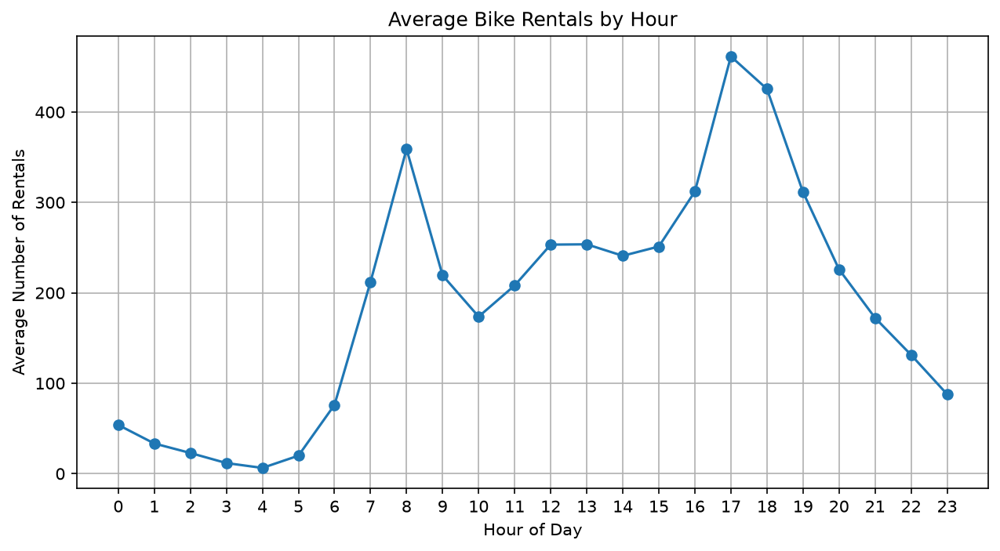
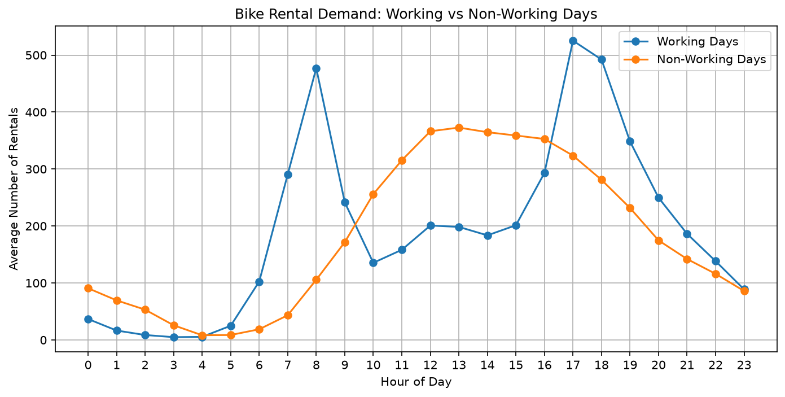
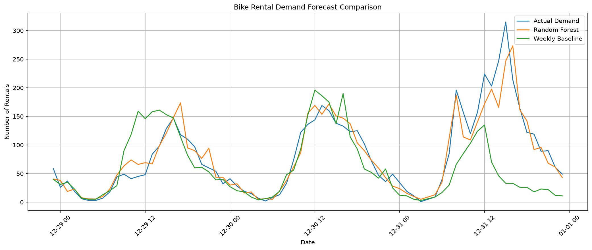

# Bike Demand Forecasting

An end-to-end beginner-friendly machine learning project that forecasts hourly bike rental demand using **Python, Pandas, SQLite, and scikit-learn**.

The project explores hourly rental patterns, creates time-based and lag features, trains a Random Forest regressor, and compares its predictions with a simple weekly baseline.

## Dataset

The project uses the [UCI Bike Sharing Dataset](https://archive.ics.uci.edu/dataset/275/bike+sharing+dataset), specifically `hour.csv`, which contains hourly bike rental data from 2011–2012.

- **Target:** `cnt` (total bike rentals during the target hour)
- **Calendar features:** hour, day of week, weekend indicator, working-day indicator
- **Lag features:** `lag_1`, `lag_24`, `lag_168` (rentals 1, 24, and 168 hours before the target hour)

The model does not use observed weather from the target hour or the target hour's rental count as input. Missing historical hours are not silently treated as zero rentals.

## Project structure

```text
bike-demand-forecasting/
├── data/
│   └── raw/
│       └── hour.csv
├── models/                     # Generated model files (not tracked)
├── reports/
│   └── figures/
│       ├── hourly_demand.png
│       ├── workingday_comparison.png
│       └── forecast_comparison.png
├── sql/
│   └── analysis.sql
├── src/
│   ├── features.py              # Calendar and lag features
│   ├── train.py                 # Model selection, training, and evaluation
│   └── predict.py               # Next-hour prediction
├── tests/
│   ├── test_features.py
│   ├── test_predict.py
│   └── test_train.py
├── bike_demand_analysis.ipynb
├── .gitignore
├── requirements.txt
└── README.md
```

## Setup (Windows PowerShell)

Run the following commands from the project root:

```powershell
py -m venv .venv
.\.venv\Scripts\Activate.ps1
python -m pip install -r requirements.txt
```

## Usage

Run all commands below from the project root so that Python can find `src` and the relative data paths resolve correctly.

### Train and evaluate

```powershell
python -m src.train
```

This command prepares lag features, uses a chronological split, selects hyperparameters using a validation period, retrains on the full training period, evaluates on the later test period, and saves the model to `models/bike_demand_model.joblib`.

### Forecast the hour after the dataset ends

```powershell
python -m src.predict --workingday 0
```

`workingday` is required: `1` for a working day, `0` for a weekend or holiday. Since the data ends on **2012-12-31**, this example forecasts **2013-01-01 00:00** using available historical rentals. It is a *historical demonstration*, not a real-time forecast for today's date. Run the training command first to create the model file.

### Run tests

```powershell
python -m pytest -v
```

The six included tests cover lag features, missing hours, duplicate timestamps, weekend flags, data preparation, and prediction logic with a dummy model.

### Explore data and SQL

Open `bike_demand_analysis.ipynb` in VS Code or Jupyter and select the project's Python environment. The notebook loads `hour.csv`, explores demand patterns, and creates the SQLite database at `data/processed/bike_sharing.db`.

The queries in `sql/analysis.sql` summarize demand by hour, day of week, month, and working versus non-working days. **Create the database through the notebook before running these queries.** The generated database file is excluded from Git.

## Results

The following results were obtained on the later 20% of the prepared historical data, with an 80% initial training period. Hyperparameters were selected using a chronological validation slice inside that training period.

| Method | Test MAE (rentals) |
|---|---:|
| Weekly baseline (same hour one week earlier) | 64.09 |
| Initial Random Forest | 30.50 |
| Tuned Random Forest (`max_depth=12`, `min_samples_leaf=3`) | 31.19 |

The tuned model reduced test MAE by approximately **51.33%** relative to the weekly baseline. It achieved **Train MAE = 16.19** and **Test MAE = 31.19**. Hyperparameter tuning reduced the train–test gap but did **not** improve the test MAE over the initial model.

The notebook reproduces the **initial** Random Forest experiment; `src/train.py` selects and trains the **tuned** model. This explains why their reported MAE values differ.

### Visualizations

**Average rentals by hour**



**Working versus non-working days**



**Actual demand, Random Forest, and weekly baseline**



The forecast comparison plot in the notebook uses the initial model and displays the last three days of the test period.

## Limitations

- The evaluation simulates **one-step-ahead forecasts** where actual historical rental counts are available before each prediction. It is not a multi-day forecast made without new observations.
- The supplied `workingday` value must be known or set correctly for the future target hour.
- The data is historical (2011–2012); real-world deployment would require updated data and retraining.
- The same test period was inspected during project development, so these results should be treated as exploratory rather than a fully untouched final benchmark.
- The project does not use future observed weather, which would be unavailable at prediction time.

## Data source

Fanaee-T, H. and Gama, J. (2013). *Bike Sharing Dataset*. UCI Machine Learning Repository. [Dataset page](https://archive.ics.uci.edu/dataset/275/bike+sharing+dataset).
